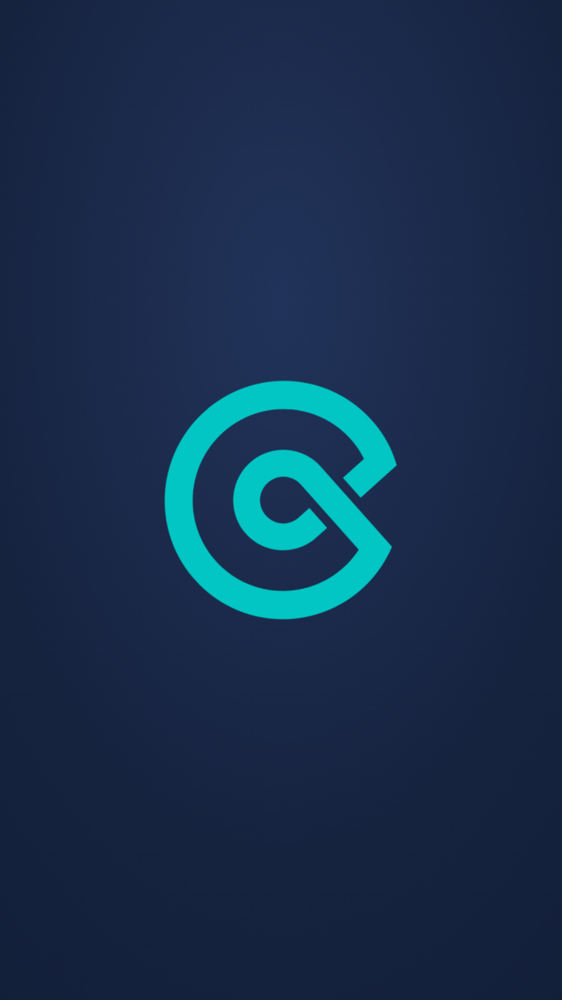

# Conecta · Núcleo de Negócios ACIGRA

> **Muito além do networking.**
> *Pessoas que fortalecem pessoas. Negócios que crescem juntos.*

Repositório-mestre da marca **Conecta**: estratégia, identidade verbal,
identidade visual, logo, fonte, tokens, código dos templates e o Guia de
Negócios. **Tudo o que é preciso para criar qualquer peça do Conecta está aqui.**

Projeto de marca: **KA | Inteligência para Marcas** (Kelly Albert).

---

## Comece por aqui

| Preciso de… | Abra |
| --- | --- |
| Entender a marca, o posicionamento e o que dizer | [`01-estrategia/posicionamento-e-essencia.md`](01-estrategia/posicionamento-e-essencia.md) |
| Cores, fonte, logo, cards e regras visuais | [`02-identidade-visual/`](02-identidade-visual/README.md) |
| Logo e símbolo (PNG oficiais) | [`assets/logo/`](assets/logo/) |
| Fonte Sora (arquivo) | [`assets/fontes/sora-var.woff2`](assets/fontes/) |
| Capas de destaque do Instagram prontas | [`assets/capas-destaques/`](assets/capas-destaques/) |
| Fotos, vídeos e logos dos parceiros (ACIGRA, Empreender) e dos 33 nucleados | [`assets/midia/`](assets/midia/README.md) |
| Vídeos prontos (retrospectiva 2026 e telão do Happy Hour) | [`assets/midia/videos_finais/`](assets/midia/README.md#videos_finais--vídeos-prontos) |
| Peças produzidas (Reels, capas, legendas) | [`producao/`](producao/) |
| Cores/gradientes prontos para código (CSS/JSON) | [`tokens/`](tokens/) |
| Código dos 10 cards do Estúdio | [`codigo-estudio/`](codigo-estudio/) |
| Guia de Negócios (site com os nucleados) | [`guia-de-negocios/`](guia-de-negocios/README.md) |
| Instruções para a IA em um chat novo | [`CLAUDE.md`](CLAUDE.md) |

## Links oficiais

- **Estúdio de Marca (cards do Conecta):** https://estudiodemarca.kellyalbert.com.br/conecta
- **Guia de Negócios:** https://guiaconecta.netlify.app
- **Instagram:** [@conecta.acigra](https://instagram.com/conecta.acigra)

---

## A marca em 30 segundos

**O que é:** Núcleo de Negócios multissetorial da ACIGRA (Associação Comercial,
Industrial e de Serviços de Gravataí/RS). É uma comunidade empresarial que
transforma encontros em relacionamentos, e relacionamentos em possibilidades de
crescimento.

**Ideia central:** antes de existirem empresas, existem pessoas. E, por trás de
cada negócio, existe uma história.

**Essência:** o Conecta aproxima empresários, fortalece pessoas e transforma
conhecimento compartilhado e relações de confiança em oportunidades de
crescimento.

**Três dimensões:** **CONECTAR** (construir relações de valor) ·
**COMUNICAR** (compartilhar e compreender) · **CAPACITAR** (desenvolver pessoas
e negócios).

**Valores:** Confiança · Colaboração · Desenvolvimento · Pertencimento ·
Protagonismo · Reciprocidade.

**Tom de voz:** editorial, sóbrio, humano e profissional. Fala da
transformação, não só das atividades. **Sem emoji.** Sem travessão em texto
corrido (usar "·" ou ":").

## O visual em 30 segundos

| | |
| --- | --- |
| **Navy** `#1B2A4A` | cor dominante (texto, gradientes) |
| **Turquesa** `#00CEC9` | acento único: tags, palavra-chave, linhas, números |
| **Warm** `#FAF9F7` | fundo claro (nunca branco puro) |
| **Sora** | fonte única: título leve + palavra-chave em negrito turquesa |
| **Símbolo** | espiral "C" (usar sempre os PNGs oficiais) |

---

## Origem dos arquivos

Tudo aqui foi consolidado a partir do repositório **SistemaKA** (out/2026):

- Identidade visual, logos, fonte, capas e código → branch `estudiodemarca`
  (a versão publicada no Estúdio de Marca), pasta `estudio-marca-ka/`.
- Guia de Negócios → pasta `conecta/` (versão publicada no Netlify, atualizada
  em 09/11/2026 com a versão de 03/11, que tem o logo de cada nucleado).
- Mídia (fotos, vídeos, logos de parceiros e nucleados) → pasta `conecta/midia/`
  e `logotipos/` da branch `claude/conecta-repository-7h00xx` (09/11/2026).
- Estratégia → texto da KA de out/2026.

**Manutenção:** tudo do Conecta fica neste repositório. Se um layout mudar no
Estúdio (SistemaKA) ou o Guia for editado lá, atualize aqui também, para este
repositório continuar sendo a fonte de verdade. Fotos, vídeos e logos novos
entram direto em `assets/midia/`.
